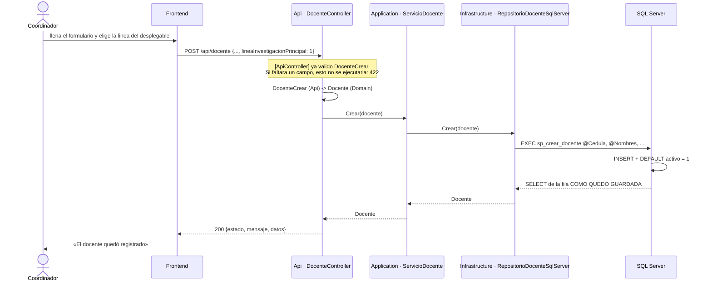
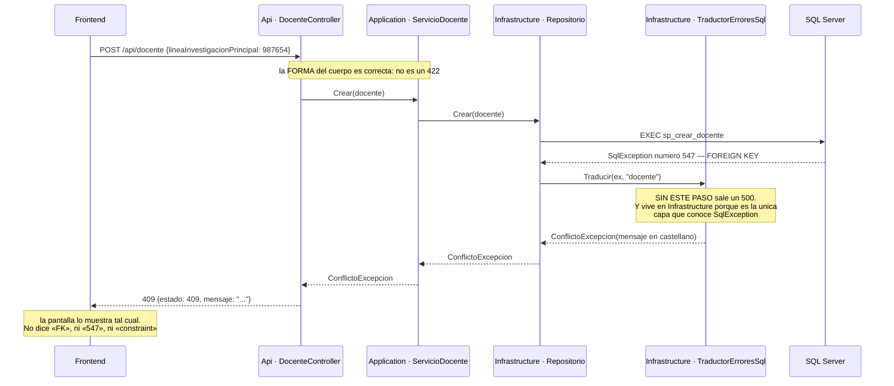
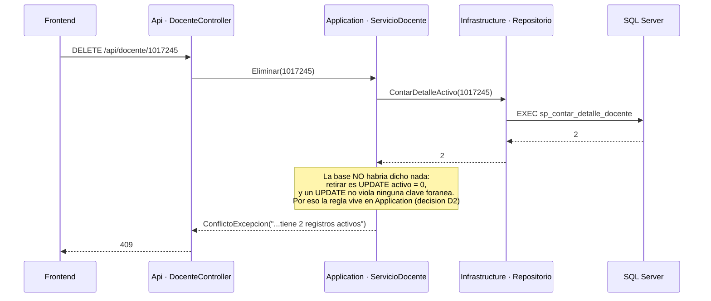
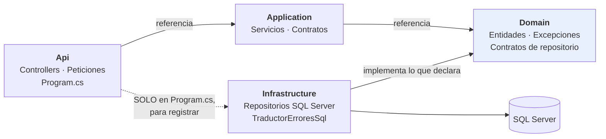

# Diagramas de secuencia — el flujo de la información

> Las cajas de estos diagramas son **clases reales del repositorio**, y los
> nombres son los que verá al abrir los archivos. Si un diagrama dijera
> «servicio → repositorio» y en el código el controlador hablara con la base,
> el diagrama no describiría el sistema: lo adornaría.
>
> Cada historia de usuario tiene el suyo en
> [`../spec_kit/0_historias_de_usuario.md`](../spec_kit/0_historias_de_usuario.md);
> los de **error** están en
> [`../spec_kit/versiones/v2_docente/6_contracts.md`](../spec_kit/versiones/v2_docente/6_contracts.md).
> Aquí están los tres que hay que saber contar de memoria.

## Los participantes, y en qué proyecto vive cada uno

| Caja | Proyecto | Archivo |
|---|---|---|
| `DocenteController` | **Api** | `src/GestionProfesoral.Api/Controllers/DocenteController.cs` |
| `ServicioDocente` | **Application** | `src/GestionProfesoral.Application/Servicios/ServicioDocente.cs` |
| `RepositorioDocenteSqlServer` | **Infrastructure** | `src/GestionProfesoral.Infrastructure/Persistencia/` |
| `sp_*` y `trg_contar_estudios` | **base de datos** | `db/gestion_profesoral.sql` |

---

## 1. El camino feliz — crear un docente

**Cómo se lee:** la petición baja por las tres capas y la respuesta sube por
las mismas. Fíjese en que **el controlador traduce dos veces**: el cuerpo HTTP
a entidad al bajar, y la entidad a JSON al subir. Ni el servicio ni el
repositorio conocen el formato del JSON.

---

## 2. El 409 de integridad — el que nace en el motor

**Cómo se lee:** el 409 **no lo inventa la API**: nace de un error del motor
que alguien tiene que traducir, y ese alguien es la capa de afuera. Hacia
adentro solo sube una excepción de dominio.

---

## 3. El 409 de regla de negocio — el que la base NO puede defender

**Cómo se lee:** compárelo con el anterior. **Los dos responden 409 y nacen en
capas distintas**: uno lo descubre el motor, el otro lo decide el negocio.
Saber distinguirlos es la pregunta más probable de la sustentación.

---

## 4. La regla de dependencias que sostiene los tres

**Cómo se lee:** todas las flechas apuntan **hacia adentro**, al dominio, que
no referencia a nadie. La punteada es la única excepción y está confinada a
`Program.cs`. Esto **no es un acuerdo**: son referencias de proyecto, y el
compilador las hace cumplir — `Application` no puede nombrar a SQL Server
aunque alguien lo intente, porque no lo referencia.
