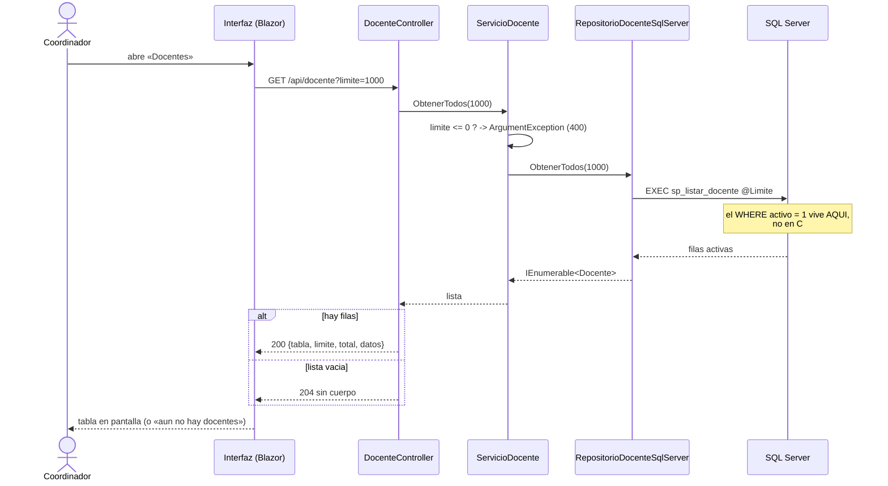
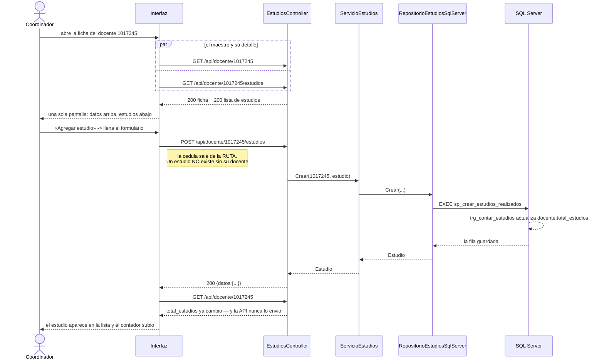
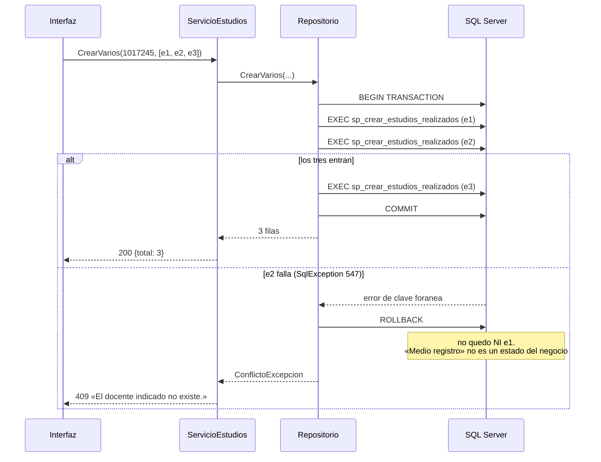
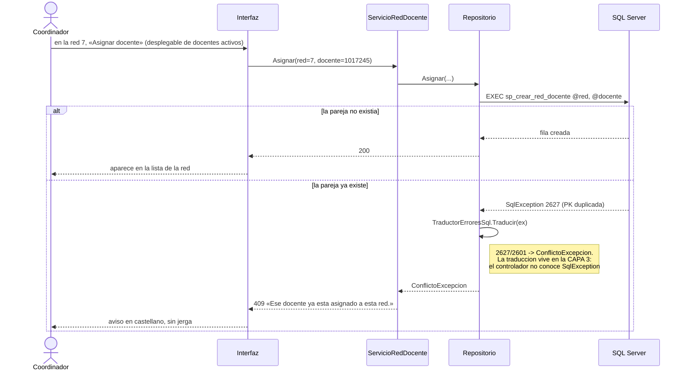
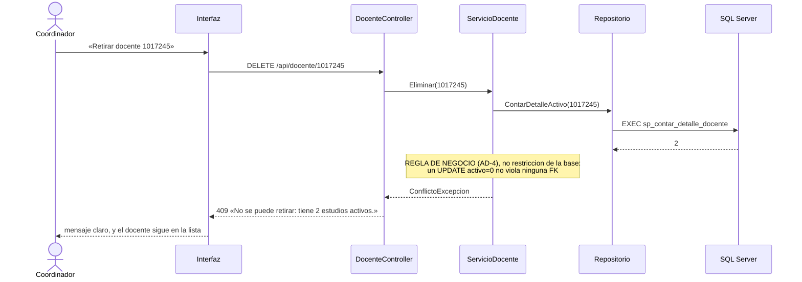

# Historias de usuario — Módulo Gestión Profesoral

> Este archivo **se amplía versión por versión**, no se reescribe. Aquí van
> las historias de la v1 (ya cerradas) y las de la **v2**, cada una con su
> **criterio de aceptación** y su **diagrama de secuencia** debajo
> (0_METODOLOGIA.md §4).
>
> **Una historia sin su secuencia es una intención; una secuencia sin su
> historia es un dibujo.** Las capas de cada diagrama son las del código:
> `Controlador` → `Servicio` → `Repositorio` → `SQL Server`.

---

## Los actores

| Actor | Quién es |
|---|---|
| **Coordinador** | Mantiene la hoja de vida de los docentes del programa |
| **Docente** | Consulta y completa su propia información académica |
| **Interfaz** | El front (Blazor Server, puerto 8075) — nunca toca la base |
| **API** | `api_gestion`, puerto 8074 |

---

# VERSIÓN 1 — cerradas (tag `v1`)

| # | Historia | Criterio de aceptación |
|---|---|---|
| H1 | Como coordinador quiero **ver los programas** para saber cuáles existen | `GET /api/programa` → 200 con el sobre, o **204** si no hay |
| H2 | Como coordinador quiero **crear un programa** | `POST /api/programa` → 200 y aparece en el listado |
| H3 | Como coordinador quiero **corregir un programa** | `PUT`/`PATCH` → 200 y el dato cambia |
| H4 | Como coordinador quiero **retirar un programa** sin perder su historia | `DELETE` → `activo = 0`, desaparece del listado, **sigue en la base** |

> Sus secuencias están en `versiones/v1_programa/3_plan.md` y `6_contracts.md`.
> **La v2 no las reabre: las vuelve a correr** (regresión, §9 de VERSION_2.md).

---

# VERSIÓN 2 — las historias nuevas

## H5 — Ver la lista de docentes

> **Como** coordinador
> **quiero** ver los docentes activos del programa
> **para** saber de quién tengo hoja de vida.

**Criterio de aceptación**
`GET /api/docente` responde **200** con `{tabla, limite, total, datos}` y
**solo** filas con `activo = 1`; si no hay ninguna, **204** sin cuerpo.
El SQL del listado está en `sp_listar_docente`, **no en el repositorio**.

**Cómo se lee:** cada caja es una clase real del repositorio. La única flecha
que llega a la base sale del repositorio — si saliera del controlador, el
diagrama estaría describiendo otro sistema.

---

## H6 — Registrar un docente eligiendo su línea de investigación de una lista

> **Como** coordinador
> **quiero** registrar un docente y **elegir** su línea de investigación de
> una lista
> **para** no tener que adivinar códigos.

**Criterio de aceptación**
El formulario trae un desplegable **cargado desde `GET /api/linea-investigacion`**
que **muestra el nombre** y **manda el `id`**; como la FK es opcional, incluye
**«(ninguna)» → `null`** (nunca cadena vacía). Solo ofrece líneas **activas**.

```mermaid
sequenceDiagram
    actor C as Coordinador
    participant F as Interfaz
    participant API as API
    participant DB as SQL Server

    Note over F,API: 1) ANTES de mostrar el formulario se llenan los desplegables
    F->>API: GET /api/linea-investigacion
    API->>DB: EXEC sp_listar_linea_investigacion
    DB-->>API: solo activas
    API-->>F: 200 {datos:[{id:3, nombre:"Ingenieria de Software"}]}
    F-->>C: <select> muestra «Ingenieria de Software», value = 3

    Note over C,F: 2) la persona elige por NOMBRE
    C->>F: elige «Ingenieria de Software» y guarda
    F->>API: POST /api/docente {"lineaInvestigacionPrincipal": 3, ...}
    Note right of F: viaja la CLAVE (3),<br/>no el texto que se leyo
    API->>DB: EXEC sp_crear_docente @cedula, @nombres, ..., @linea
    DB-->>API: la fila COMO QUEDO GUARDADA
    API-->>F: 200 {datos: {...}}
    F-->>C: «Docente registrado»
```

**Cómo se lee:** son **dos** viajes y hay que saber decirlo: uno para llenar
el desplegable y otro para guardar. En la pantalla se lee un nombre; en la
petición viaja un número.

---

## H7 — Ver y agregar los estudios de un docente desde su propia ficha

> **Como** coordinador
> **quiero** abrir un docente y ver **ahí mismo** sus estudios, y agregarle
> uno sin salir de la pantalla
> **para** no tener que volver a decir de qué docente se trata.

**Criterio de aceptación**
Al abrir `/docentes/1017245` se ven los estudios de ese docente, y el botón
«Agregar estudio» registra uno **con el docente ya fijado por la ruta**
(`POST /api/docente/1017245/estudios`). No existe una pantalla suelta de
estudios donde haya que volver a elegir el docente.

**Cómo se lee:** la última pareja de flechas es la **demostración del
disparador**: el contador cambia sin que la API lo haya mandado.

---

## H8 — Registrar varios estudios de una sola vez

> **Como** coordinador
> **quiero** cargar los tres títulos de un docente en **un solo envío**
> **para** que no quede medio registro guardado si uno falla.

**Criterio de aceptación**
`POST /api/docente/{cedula}/estudios/lote` con un arreglo de tres estudios
inserta **los tres o ninguno**. Si el segundo viola una restricción, la
respuesta es **409** y en la base **no quedó ninguno**.

**Cómo se lee:** la atomicidad (la **A** de ACID) no es teoría: es el
`BEGIN`/`ROLLBACK` que se ve en `RepositorioEstudiosSqlServer.CrearVarios`.

---

## H9 — Asignar un docente a una red (tabla puente)

> **Como** coordinador
> **quiero** asignar un docente a una red de conocimiento, y poder retirarlo
> **para** registrar en qué redes participa.

**Criterio de aceptación**
`POST /api/red/{idr}/docentes` con `{docente: 1017245}` crea la pareja.
**Repetir la misma pareja responde 409**, no 500. Se retira con
`DELETE /api/red/{idr}/docentes/{cedula}` (borrado lógico).
**La pareja no se edita**: no hay botón de editar en una tabla puente.

**Cómo se lee:** el 409 nace de un error del motor que **alguien tiene que
traducir**. Si nadie lo traduce, sale un 500 y el criterio 7 queda fallado.

---

## H10 — Retirar un docente que todavía tiene estudios activos

> **Como** coordinador
> **quiero** que el sistema me impida retirar un docente que todavía tiene
> información activa colgando
> **para** no dejar huérfanos que la base no va a detener.

**Criterio de aceptación**
`DELETE /api/docente/{cedula}` con detalle activo responde **409** en
castellano. Con el detalle ya retirado, responde **200** y el docente
desaparece de los listados. **Esta regla vive en `ServicioDocente`**, no en
la base: con borrado lógico un `UPDATE` no viola ninguna clave foránea.

**Cómo se lee:** esta es la historia que mejor muestra **dónde va una regla**.
La base no la puede defender, así que la defiende la capa 2 — y por eso se
prueba sin base de datos.

---

## Tabla de trazabilidad: historia → endpoint → criterio de VERSION_2.md

| Historia | Endpoints | Criterios que cubre |
|---|---|---|
| H5 | `GET /api/docente` | 2, 3, 10 |
| H6 | `GET /api/linea-investigacion` · `POST /api/docente` | 5, 6 |
| H7 | `GET /api/docente/{c}/estudios` · `POST …/estudios` | 4, 9 |
| H8 | `POST …/estudios/lote` | 9 (un solo envío) |
| H9 | `POST /api/red/{idr}/docentes` · `DELETE …/{cedula}` | 7, 8 |
| H10 | `DELETE /api/docente/{cedula}` | 7, 10 |
| H1–H4 (v1) | `/api/programa` | 1, 12 (regresión) |
