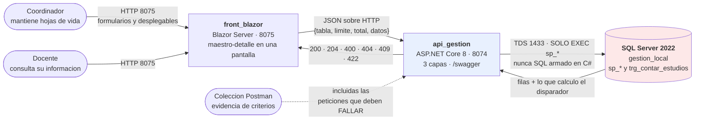

# Especificación — Versión 2: `docente` y las 11 tablas con clave foránea

> **Versión 2** ([mapa](../0_mapa_versiones.md)) · Describe **solo el delta**
> sobre la v1. Ante conflicto, manda la [constitución](../../1_constitution.md).
> Las historias que esta spec implementa (H5–H10) están en
> [0_historias_de_usuario.md](../../0_historias_de_usuario.md), cada una con
> su diagrama de secuencia.

## 1. Propósito de la v2

Completar el módulo Gestión Profesoral con **las 11 tablas que tienen clave
foránea**, y mover **todo el SQL a procedimientos almacenados** —también el
de la v1—, con **al menos un disparador** funcionando y **ninguna clave
foránea digitada a mano**.

La v1 dejó el patrón montado sobre una tabla suelta. La v2 contesta lo que
la v1 no tenía que contestar: **qué pasa cuando un registro depende de otro.**

## 2. Diagrama de contexto

**Cómo se lee:** las cajas son procesos que corren por separado; las flechas
dicen **qué viaja**, no solo que hay conexión. La flecha punteada es la
evidencia de la entrega. **No hay ninguna flecha del front a la base**: si
la hubiera, la arquitectura estaría rota (rúbrica, criterio «Separación
API/Front»).

## 3. Alcance

### Incluye

| | Qué |
|---|---|
| **Tablas** | `docente` · `estudios_realizados` · `docente_departamento` · `intereses_futuros` · `evaluacion_docente` · `reconocimiento` · `experiecia` · `red_docente` · `estudio_ac` · `apoyo_profesoral` · `beca` |
| **Verbos** | Los cinco de cada tabla, **todos por procedimiento almacenado**: listar, consultar, crear, actualizar, eliminar |
| **Migración de la v1** | Los repositorios de `programa`, `area_conocimiento`, `termino_clave`, `linea_investigacion` y `red` pasan **también** a procedimientos |
| **Disparador** | `trg_contar_estudios` sobre `estudios_realizados` (propuesta **A** de VERSION_2.md §5) |
| **Interfaz** | Pantalla por recurso + **maestro-detalle en una sola pantalla** + desplegables cargados de la API |
| **Integridad** | `409` en castellano para padre inexistente, pareja repetida y maestro con detalle activo |
| **Lote** | Alta de varios renglones de detalle en **un solo envío y una sola transacción** |

### NO incluye — y no se anticipa (Artículo 1)

- `usuario`, `rol`, `rol_usuario`, inicio de sesión, JWT, permisos → **v3**
- Consultas multitabla, dashboard, gráficos, páginas corporativas, publicación → **v4**
- **Reactivar** un registro inactivo (`activo = 1`)
- Reportes, exportación a Excel o PDF

## 4. Requisitos funcionales

### RF1 — CRUD completo de las 11 tablas por procedimiento almacenado
Cada tabla expone sus cinco verbos. **Ningún repositorio contiene SQL
escrito a mano**: todos usan `CommandType.StoredProcedure`.

### RF2 — El procedimiento de crear devuelve la fila como quedó guardada
`sp_crear_<tabla>` termina con un `SELECT` de la fila recién insertada, para
que la respuesta traiga los valores por defecto de la base y lo calculado
por el disparador.

### RF3 — Borrado lógico en todas las tablas
`sp_eliminar_<tabla>` hace `UPDATE … SET activo = 0`. **Ningún `DELETE`
físico.** Todos los listados y todos los desplegables filtran `activo = 1`.

### RF4 — Clave foránea = desplegable cargado de la API
Nunca un campo de texto donde va un código. El desplegable **muestra el
nombre** y **manda la clave**, y se llena con el listado de la tabla padre
(que ya filtra inactivos). Si la FK es opcional, lleva **«(ninguna)» → `null`**.

### RF5 — Maestro-detalle en una sola pantalla
Al abrir un `docente` se ven **ahí mismo** sus `estudios_realizados`,
`evaluacion_docente`, `reconocimiento` y `experiecia`, y se pueden agregar
sin salir. Rutas anidadas: `GET|POST /api/docente/{cedula}/estudios`.

### RF6 — Alta múltiple en un solo envío
`POST /api/docente/{cedula}/estudios/lote` recibe un arreglo y lo inserta en
**una transacción**: entran todos o no entra ninguno.

### RF7 — Integridad referencial → 409, nunca 500

| Qué hace alguien | Qué responde la API |
|---|---|
| Crear un hijo cuyo padre no existe | **409** «El docente indicado no existe.» |
| Repetir la pareja en una tabla puente | **409** «Ese docente ya está asignado a esta red.» |
| Retirar un maestro con detalle activo | **409** «No se puede retirar: tiene N estudios activos.» |

### RF8 — Al menos un disparador funcionando
`docente.total_estudios` se mantiene solo, y **escucha `INSERT`, `UPDATE` y
`DELETE`** (con borrado lógico, retirar es un `UPDATE`).

### RF9 — Las tablas puente se asignan y se retiran, no se editan
`docente_departamento`, `intereses_futuros`, `red_docente` y `estudio_ac`
tienen **asignar** y **retirar**. No tienen botón de editar.

### RF10 — Regresión de la v1
Los 7 endpoints y los criterios de la v1 siguen pasando, con su pantalla.

## 5. Requisitos no funcionales

| | |
|---|---|
| **Idioma** | Código, rutas, mensajes y documentos en castellano. La interfaz **no dice** «PUT», «PATCH», «422» ni «FK» |
| **Secretos** | La cadena de conexión llega por **variable de entorno** (`ConnectionStrings__SqlServer` en `docker-compose.yml`). Hay `.env.example`; el `.env` está en `.gitignore` |
| **Arranque** | `docker compose up -d --build` deja los tres servicios arriba |
| **Asincronía** | Todo el camino es `async`/`await`: una petición no bloquea un hilo esperando a la base |
| **Pruebas** | La prueba de capas corre **sin base de datos** |

## 6. Decisiones que este equipo toma y escribe

| # | Pregunta que VERSION_2.md deja abierta | Decisión |
|---|---|---|
| **D1** | ¿El borrado es lógico? | **Sí.** Las 19 tablas del esquema traen `activo BIT NOT NULL DEFAULT 1` |
| **D2** | ¿Se puede retirar un maestro con detalle activo? | **No.** La base no lo impide (es un `UPDATE`), así que es regla de negocio: vive en `ServicioDocente` y responde **409** |
| **D3** | ¿Qué pasa con el detalle cuando se retira el maestro? | Nada automático: hay que retirarlo primero. **No hay cascada lógica**, porque borraría en silencio |
| **D4** | ¿Las tablas puente se pueden reactivar? | **No en la v2.** Retirada una pareja, volver a asignarla da 409 si la fila existe inactiva → *se resuelve en la v3* |
| **D5** | ¿`apoyo_profesoral` y `beca` (1 a 1) son recursos o paneles? | **Recursos propios** con ruta `/api/estudios/{id}/apoyo` y `/api/estudios/{id}/beca`, mostrados como panel dentro de la ficha del estudio |
| **D6** | ¿Qué disparador se elige de los cinco? | La **propuesta A**: contador `docente.total_estudios`, por ser la más fácil de demostrar en voz alta |

## 7. Compuerta 1 — Clarificaciones

> Las ambigüedades **se marcan, no se rellenan**. Esta sección debe quedar
> **sin ningún `[NECESITA ACLARACIÓN]`** antes de escribir el `3_plan.md`.

| # | Lo que estaba ambiguo | Cómo se resolvió |
|---|---|---|
| A1 | «Todas las tablas pasan por procedimientos»: ¿también las de la v1? | **Sí.** Criterio 3 dice *todas*. Entra la migración de los 5 repositorios de la v1 |
| A2 | ¿`experiecia` se corrige a `experiencia`? | **No.** El nombre de la tabla es el del esquema dado; renombrar rompería el script. El error se documenta aquí y la **pantalla** sí dice «Experiencia» |
| A3 | ¿`estudios_realizados.id` lo pone la base o la API? | Lo manda la API: la tabla **no** es `IDENTITY` (sí lo son `evaluacion_docente`, `reconocimiento` y `experiecia`) |
| A4 | ¿`red_docente.fecha_fin` es `VARCHAR(45)` por error? | Es lo que dice el esquema. Se respeta y se trata como texto; cambiarlo sería alterar el esquema dado |
| A5 | ¿El lote es obligatorio para todo detalle? | Solo para `estudios_realizados` en la v2, que es donde se demuestra la transacción |

## 8. Criterios de aceptación de la v2

Son los **doce** de `VERSION_2.md` §8. Se copian aquí para poder marcarlos:

| # | Criterio | Se comprueba |
|---|---|---|
| 1 | Las tablas de la v1 tienen CRUD completo y su interfaz | Se abre cada una |
| 2 | Las 11 tablas de la v2, también | Una por una |
| 3 | Los cinco verbos de **todas** las tablas por procedimiento | `grep -ri "SELECT\|INSERT\|UPDATE\|DELETE" api_gestion/Repositorios/` sin resultados |
| 4 | Al menos un disparador funciona | Se agrega un estudio **por la interfaz** y el contador cambia solo |
| 5 | Cada FK se elige de un desplegable **lleno**, con nombres | Se abre el formulario |
| 6 | La FK opcional acepta «(ninguna)» → `null` | Se crea un docente sin línea |
| 7 | Hijo con padre inexistente → **409** en castellano | Postman. **Un 500 es criterio fallado** |
| 8 | Las tablas puente se asignan y se retiran; repetir da 409 | Postman |
| 9 | El detalle se ve y se agrega **desde el maestro** | Se abre un docente |
| 10 | Los listados filtran inactivos | Se retira uno: desaparece de la lista, **sigue en la base** |
| 11 | La interfaz no habla en jerga | Se recorren las pantallas |
| 12 | La regresión de la v1 pasa completa | Colección `coleccion_v1` entera en verde |
