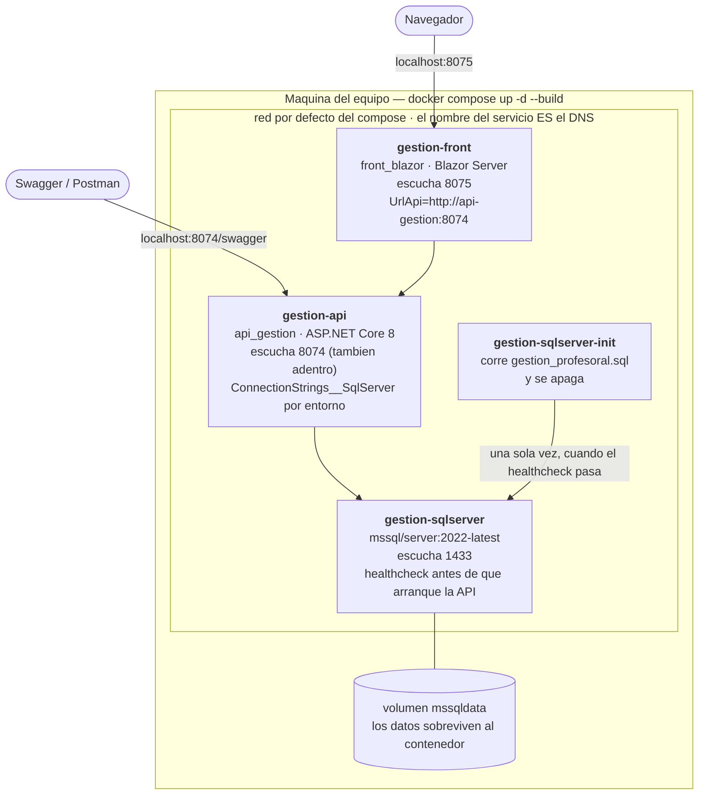
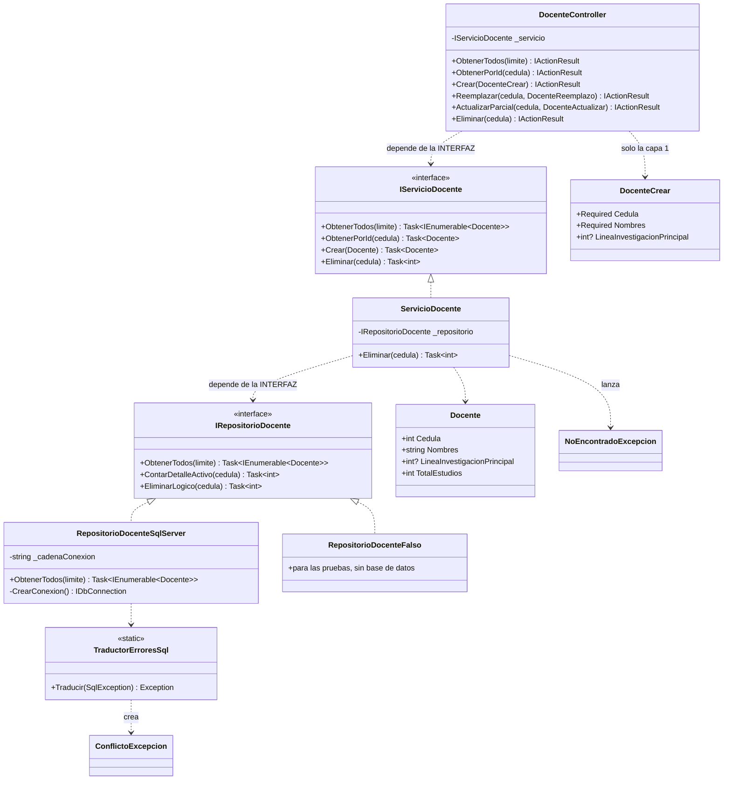
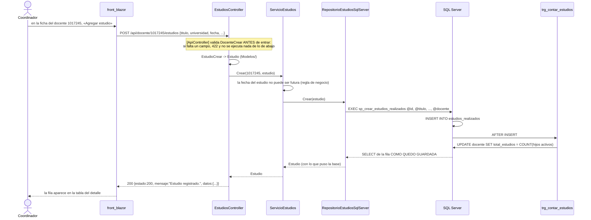

# Plan técnico — Versión 2

> Cómo se construye lo que pide el [2_spec.md](2_spec.md). Tres diagramas
> obligatorios: **despliegue**, **clases** y **la secuencia del camino feliz**.

## 1. Despliegue — los servicios del compose con sus puertos



**Cómo se lee:** cada caja es un contenedor del `docker-compose.yml`. Los
puertos de la izquierda de cada `ports:` son los de la máquina; los de la
derecha, los de adentro. **La v2 no agrega contenedores**: agrega
procedimientos al script que corre `gestion-sqlserver-init`.

> **Lo que cambia en el despliegue:** el script de la base ahora trae, además
> de las 19 tablas, los **55 procedimientos** (5 × 11) y **un disparador**.
> Para recargarlo: `docker compose down -v && docker compose up -d --build`
> — el `-v` borra el volumen, que es lo que hace que el script vuelva a correr.

## 2. Clases — la rebanada de `docente` con sus interfaces



**Cómo se lee:** las flechas punteadas son dependencias y **todas apuntan a
una interfaz**, nunca a una clase concreta. `RepositorioDocenteFalso`
implementa la misma interfaz: por eso el servicio se prueba sin base de datos.
`DocenteCrear` **solo** lo toca el controlador — las clases de `Peticiones/`
son la frontera HTTP y no cruzan a la capa 2.

## 3. Secuencia del camino feliz — crear un estudio desde la ficha del docente



**Cómo se lee:** cada participante es una clase o un objeto de base de datos
**con su nombre real**. Fíjese en que el disparador se dispara **dentro** de
la base, después del `INSERT` y antes de que la respuesta vuelva: por eso la
fila que devuelve el procedimiento ya trae el contador al día.

## 4. Plan de construcción

### 4.1 Orden (y por qué este orden)

| Fase | Qué | Por qué va aquí |
|---|---|---|
| **0** | Migrar los 5 repositorios de la v1 a procedimientos | Es el criterio 3 y toca código existente: si se deja al final, se hace con prisa |
| **1** | `docente` completo (API + pantalla) | Es el maestro del que cuelga casi todo: sin él, los desplegables están vacíos |
| **2** | `estudios_realizados` + disparador + lote | Es la rebanada que demuestra maestro-detalle, transacción y disparador |
| **3** | Los otros tres detalles de `docente` | Mismo patrón, otros nombres |
| **4** | Las 4 tablas puente | Necesitan que los dos padres existan |
| **5** | `apoyo_profesoral` y `beca` (1 a 1) | Cuelgan de `estudios_realizados` |
| **6** | Regresión + colección de Postman + tag `v2` | Lo último, con todo arriba |

### 4.2 La plantilla de una rebanada (8 archivos por tabla)

```
Modelos/<Tabla>.cs
Peticiones/<Tabla>Crear.cs          ← [Required], [StringLength] : aquí nace el 422
Peticiones/<Tabla>Actualizar.cs     ← todo opcional : aquí nace el PATCH
Repositorios/IRepositorio<Tabla>.cs
Repositorios/Repositorio<Tabla>SqlServer.cs   ← SOLO CommandType.StoredProcedure
Servicios/IServicio<Tabla>.cs
Servicios/Servicio<Tabla>.cs        ← las reglas y el 409
Controllers/<Tabla>Controller.cs    ← [Route("api/<tabla>")], ruta en minúscula
```

Y **dos líneas** en `Program.cs`, el único sitio donde una clase concreta se
nombra junto a su interfaz.

### 4.3 Nombres, y por qué importan

| Cosa | Convención | Ejemplo |
|---|---|---|
| Tabla y ruta | minúscula, guion en vez de guion bajo | `estudios_realizados` → `/api/estudios-realizados` |
| Procedimiento | `sp_<verbo>_<tabla>` | `sp_crear_estudios_realizados` |
| Disparador | `trg_<lo que hace>` | `trg_contar_estudios` |
| JSON | **camelCase** (es lo que ASP.NET hace por defecto) | `fechaInicio`, `totalEstudios` |
| Columnas | snake_case, con alias en el procedimiento | `fecha_inicio AS FechaInicio` |

> El alias va **en el procedimiento**, no en C#: así Dapper mapea por nombre
> sin configurar nada.

### 4.4 Dónde se corta cada error

```
422 → en [ApiController], ANTES del controlador (cuerpo inválido)
400 → en el servicio (limite <= 0, PATCH sin campos)
404 → en el servicio (el repositorio devolvió null o 0 filas)
409 → en el repositorio (TraductorErroresSql) o en el servicio (regla D2)
500 → lo que nadie atrapó: en la v2 debería ser SOLO la base caída
```

## 5. Compuerta 2 — Chequeo de constitución

| Artículo | Qué exige | ¿El plan lo respeta? |
|---|---|---|
| **1. No anticipar** | Nada de versiones futuras | ✅ Ni `usuario`, ni token, ni dashboard |
| **2. Dapper, SQL a la vista** | El SQL se ve y va parametrizado | ⚠️ **Enmienda:** en la v2 el SQL se ve **en el script de la base**, no en el `.cs`. Dapper se queda, como **invocador** de procedimientos. *Se enmienda la constitución, no se deja pasar* |
| **3. Capas por interfaz** | Solo `Program.cs` une concreto con interfaz | ✅ |
| **6. Borrado lógico** | `activo = 0` y listados filtrados | ✅ en las 11 tablas |
| **9. El contrato al pie de la letra** | Lo que dice `6_contracts.md` es lo que responde | ✅ incluida la colección de Postman con las peticiones que deben fallar |
| **10. Rutas en minúscula** | `/api/docente`, no `/api/Docente` | ✅ ruta escrita completa, sin `[controller]` |
| **Secretos** | Nada quemado en el código | ✅ por `environment:` + `.env.example` |

> **La fila amarilla es la que hay que saber sustentar.** La constitución
> decía «el SQL se escribe a mano y queda a la vista». La v2 exige
> procedimientos. No se deja pasar: **se enmienda el artículo 2** diciendo que
> desde la v2 el SQL vive en la base, versionado en el script, y el
> repositorio solo lo invoca. El principio de fondo —*el SQL se ve y va
> parametrizado*— se mantiene; cambia dónde se ve.
