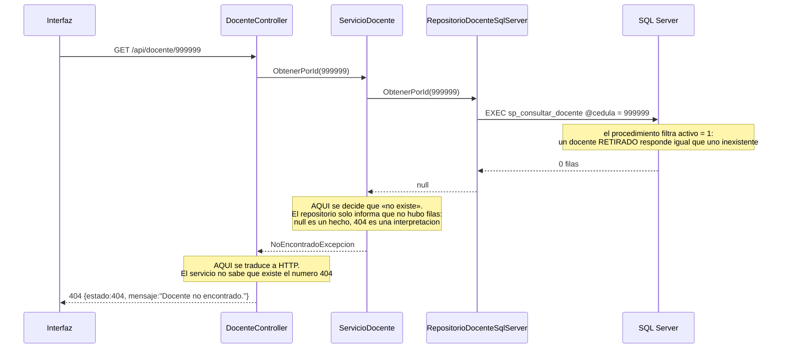
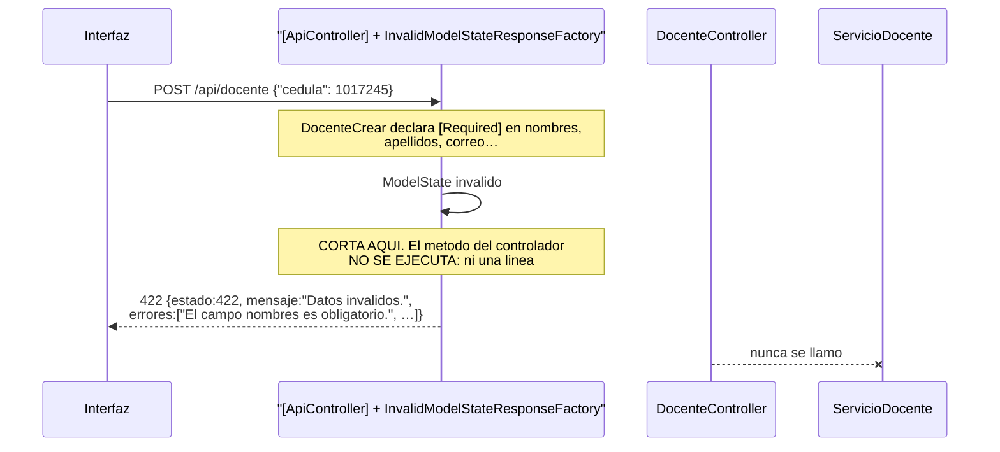
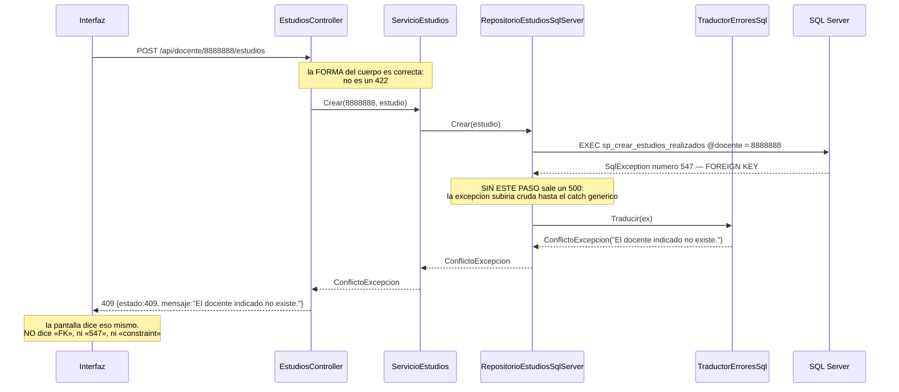
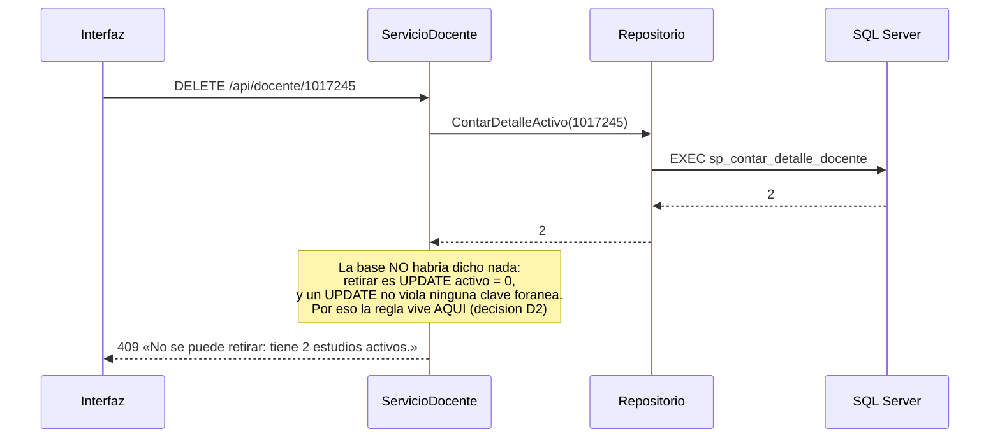

# Contratos HTTP — Versión 2

> Base: `http://localhost:8074` · documentación interactiva en `/swagger`.
> Lo que este documento dice se cumple **al pie de la letra** (Artículo 9).
> **El delta sobre la v1**: las rutas nuevas, el 409 y las rutas anidadas.

## 0. Convenciones (heredadas de la v1, sin cambios)

**Sobre de lectura** — nunca una lista pelada:

```json
{ "tabla": "docente", "limite": 1000, "total": 2, "datos": [ … ] }
```

**Sobre de error:**

```json
{ "estado": 409, "mensaje": "El docente indicado no existe.", "detalle": "…" }
```

`errores[]` aparece **solo** en el 422. Los campos JSON van en **camelCase**.

### Catálogo de códigos de la v2

| Situación | Código | Quién lo decide |
|---|---|---|
| Lectura o escritura correcta | **200** | Controlador |
| Lectura sin filas activas | **204** sin cuerpo | Controlador |
| Regla rota (`limite` ≤ 0, `PATCH` vacío) | **400** | Servicio |
| Cuerpo inválido (falta campo, tipo, largo) | **422** | `[ApiController]`, antes del controlador |
| No existe, o está inactivo | **404** | Servicio |
| **Padre inexistente · pareja repetida · maestro con detalle activo** | **409** | **Repositorio (traductor) o servicio (regla)** |
| La base está caída | **500** | Nadie lo atrapó |

> **`409` es la novedad de esta versión.** La v1 no tenía claves foráneas, así
> que no podía tener conflictos de integridad. **Un 500 donde debía ir un 409
> es criterio fallado** (criterio 7).

---

## 1. Las rutas de la v2

### 1.1 Recursos propios

```
GET    /api/docente[?limite=N]          POST   /api/docente
GET    /api/docente/{cedula}            PUT    /api/docente/{cedula}
PATCH  /api/docente/{cedula}            DELETE /api/docente/{cedula}
```

Igual para `evaluacion-docente`, `reconocimiento`, `experiencia`,
`estudios-realizados`.

### 1.2 Detalle anidado bajo su maestro

```
GET    /api/docente/{cedula}/estudios
POST   /api/docente/{cedula}/estudios
POST   /api/docente/{cedula}/estudios/lote      ← varios en UN envío
GET    /api/docente/{cedula}/evaluaciones
GET    /api/docente/{cedula}/reconocimientos
GET    /api/docente/{cedula}/experiencias
```

> **Por qué anidadas:** la ruta dice lo que el negocio dice. *Un estudio no
> existe sin su docente*, así que la cédula no es un filtro opcional: es parte
> de la identidad del recurso.

### 1.3 Tablas puente — asignar y retirar, nunca editar

```
GET    /api/red/{idr}/docentes
POST   /api/red/{idr}/docentes                  {"docente": 1017245, …}
DELETE /api/red/{idr}/docentes/{cedula}

GET    /api/docente/{cedula}/departamentos
POST   /api/docente/{cedula}/departamentos      {"departamento": 9001, …}
DELETE /api/docente/{cedula}/departamentos/{programa}

GET    /api/docente/{cedula}/intereses
POST   /api/docente/{cedula}/intereses          {"terminoClave": "IA"}
DELETE /api/docente/{cedula}/intereses/{termino}

GET    /api/estudios-realizados/{id}/areas
POST   /api/estudios-realizados/{id}/areas      {"areaConocimiento": "01"}
DELETE /api/estudios-realizados/{id}/areas/{area}
```

**No hay `PUT` ni `PATCH` en estas rutas, y es a propósito:** una pareja
existe o no existe. Cambiarla es retirar una y asignar otra.

### 1.4 Extensiones 1 a 1

```
GET|POST|PUT|DELETE  /api/estudios-realizados/{id}/apoyo
GET|POST|PUT|DELETE  /api/estudios-realizados/{id}/beca
```

---

## 2. Ejemplos del camino feliz

### `POST /api/docente` — con la FK opcional en «(ninguna)»

```json
// petición
{ "cedula": 1017245, "nombres": "Ana", "apellidos": "Torres Gomez",
  "genero": "Femenino", "cargo": "Titular", "fechaNacimiento": "1980-04-12",
  "correo": "ana.torres@umv.edu.co", "telefono": "3001234567",
  "urlCvlac": "https://cvlac.minciencias.gov.co/...", "escalafon": "Asociado",
  "perfil": "Doctora en …", "convMinciencia": "2023",
  "nacionalidaad": "Colombiana",
  "lineaInvestigacionPrincipal": null }          // «(ninguna)», NO cadena vacía
```

```json
// 200 — la fila COMO QUEDÓ GUARDADA
{ "estado": 200, "mensaje": "Docente registrado.",
  "datos": { "cedula": 1017245, "nombres": "Ana", …,
             "lineaInvestigacionPrincipal": null,
             "totalEstudios": 0 } }              // lo puso la base, no la API
```

> `activo` **no viaja**: es de la base y no es asunto de quien consume la API.

### `POST /api/docente/1017245/estudios/lote` — tres en un envío

```json
{ "estudios": [ { "id": 501, "titulo": "Ingeniería de Sistemas", … },
                { "id": 502, "titulo": "Maestría en Software",   … },
                { "id": 503, "titulo": "Doctorado en Computación", … } ] }
```

```json
// 200 — entraron los tres
{ "estado": 200, "mensaje": "Se registraron 3 estudios.", "total": 3 }
```

---

## 3. LAS SECUENCIAS DE ERROR (diagramas obligatorios)

### 3.1 El 404 — quién decide que «no existe»



**Guía de lectura:** tres capas y **tres responsabilidades distintas sobre el
mismo hecho**. El repositorio dice «no hay filas», el servicio dice «no
existe», el controlador dice «404». Si el repositorio devolviera un
`NotFound()`, la capa 3 estaría hablando HTTP — y el servicio ya no se podría
probar sin ASP.NET.

### 3.2 El 422 — dónde corta la validación



**Guía de lectura:** la cruz dice que esa llamada **no ocurrió**. La
validación de **forma** se resuelve en la frontera, antes de gastar una
conexión a la base. Por defecto ASP.NET responde 400 con `ProblemDetails`;
el `Program.cs` reemplaza la fábrica para que responda **422 con nuestro
sobre** — eso es lo que hace que el contrato se cumpla al pie de la letra.

### 3.3 El 409 de integridad — el que define esta versión



**Guía de lectura:** el 409 no lo inventa la API: **nace de un error del
motor** (547) que **alguien tiene que traducir**, y ese alguien es la capa 3,
que es la única que conoce `SqlException`. Si la traducción estuviera en el
controlador, la capa 1 tendría que importar `Microsoft.Data.SqlClient` — una
fuga de la capa de datos hasta arriba.

### 3.4 El 409 de la regla de negocio — el que la base NO puede defender



**Guía de lectura:** compare con el 3.3. **Los dos responden 409 y nacen en
sitios distintos**: uno lo descubre el motor, el otro lo decide el negocio.
Saber distinguirlos es la pregunta de sustentación más probable de esta
versión.

---

## 4. Tabla de desenlaces por endpoint

| Endpoint | 200 | 204 | 400 | 404 | 409 | 422 |
|---|---|---|---|---|---|---|
| `GET /api/docente` | hay filas | sin filas activas | `limite ≤ 0` | — | — | — |
| `GET /api/docente/{c}` | existe y activo | — | — | no existe o inactivo | — | — |
| `POST /api/docente` | creado | — | — | — | cédula repetida · línea inexistente | falta un campo |
| `PATCH /api/docente/{c}` | actualizado | — | sin campos | no existe | línea inexistente | tipo inválido |
| `DELETE /api/docente/{c}` | retirado | — | — | no existe o ya inactivo | **tiene detalle activo** | — |
| `POST …/{c}/estudios` | creado | — | — | — | **docente inexistente** | falta un campo |
| `POST …/estudios/lote` | entraron todos | — | arreglo vacío | — | **uno falló → no entró ninguno** | un elemento inválido |
| `POST /api/red/{i}/docentes` | asignado | — | — | — | **pareja repetida** | falta la cédula |
| `DELETE /api/red/{i}/docentes/{c}` | retirado | — | — | la pareja no existe | — | — |

---

## 5. La colección de Postman: las peticiones que TIENEN que fallar

Se entrega `postman/coleccion_v2.postman_collection.json` con una carpeta
**«Deben fallar»**, porque un criterio solo está probado si se probó el
desenlace malo:

| Petición | Esperado |
|---|---|
| Crear estudio con docente `8888888` | **409**, no 500 |
| Asignar dos veces el mismo docente a la red 7 | **409** |
| Retirar un docente con estudios activos | **409** |
| Crear docente sin `nombres` | **422** con `errores[]` |
| `GET /api/docente?limite=0` | **400** |
| `GET /api/docente/999999` | **404** |
| Listar cuando no hay ninguno | **204** sin cuerpo |
