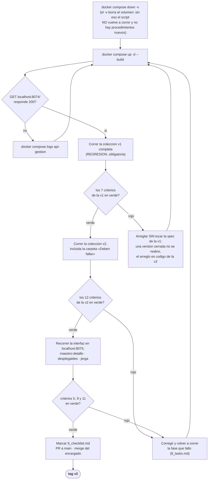

# Quickstart — Versión 2

> Cómo se levanta, cómo se comprueba y qué significa «terminado».

## 1. El ciclo de validación



**Cómo se lee:** verde no es «compila»: es **la colección pasando**. Y la
regresión de la v1 va **antes** que lo nuevo, porque si la v2 rompió la v1 no
tiene sentido seguir probando la v2.

## 2. Levantar

```bash
docker compose down -v          # borra el volumen: el script vuelve a correr
docker compose up -d --build
docker compose ps               # los 3 arriba, sqlserver-init apagado (exit 0)
```

| Dirección | Qué es |
|---|---|
| `http://localhost:8075` | La interfaz |
| `http://localhost:8074` | La API (diagnóstico) |
| `http://localhost:8074/swagger` | Los contratos, que es lo que se proyecta al sustentar |

> **El `.env`.** La cadena de conexión llega por variable de entorno. Copie
> `.env.example` a `.env` y ponga ahí la contraseña: el `.env` **no se sube**
> (está en `.gitignore`).

## 3. Comprobar los doce criterios, uno por uno

| # | Qué se hace | Qué tiene que pasar |
|---|---|---|
| 1 | Abrir Programas, crear, editar, retirar | Funciona igual que en la v1 |
| 2 | Lo mismo con las 11 tablas nuevas | Funciona |
| 3 | `grep -riE "SELECT\|INSERT\|UPDATE\|DELETE\|FROM" api_gestion/Repositorios/` | **Sin resultados** |
| 3b | `grep -c StoredProcedure api_gestion/Repositorios/*.cs` | 5 o más por archivo |
| 4 | Agregar un estudio **por la interfaz** y recargar la ficha | `total_estudios` subió, **y la API no lo envió** |
| 4b | Retirar ese estudio **por la interfaz** | El contador **bajó** (esto es lo que falla si el disparador no oye el `UPDATE`) |
| 5 | Abrir el formulario de docente | El desplegable de línea está **lleno**, con nombres |
| 6 | Crear un docente dejando «(ninguna)» | 200 y `lineaInvestigacionPrincipal: null` |
| 7 | Postman: crear estudio con docente `8888888` | **409** en castellano. Un 500 **falla el criterio** |
| 8 | Asignar docente a red, repetir, retirar | 200 · **409** · 200 |
| 9 | Abrir un docente | Sus estudios están **en esa misma pantalla** |
| 10 | Retirar un docente y mirar la base | Desapareció de la lista, **sigue con `activo = 0`** |
| 11 | Recorrer las pantallas | No dice «PUT», «PATCH», «422», «FK», «constraint» |
| 12 | Correr la colección v1 entera | Todo en verde |

### Cómo mirar la base para el criterio 10

```bash
docker exec -it gestion-sqlserver /opt/mssql-tools18/bin/sqlcmd \
  -S localhost -U sa -P "$SA_PASSWORD" -C -d gestion_local \
  -Q "SELECT cedula, nombres, activo, total_estudios FROM docente"
```

Se ve la fila con `activo = 0`: **el dato no se perdió, se retiró.** Esa es
la diferencia que hay que poder decir en voz alta.

## 4. Correr la prueba de capas (sin base de datos)

```bash
cd api_gestion/pruebas
dotnet test
```

**Lo importante no es que pase: es que corra con los contenedores
apagados.** Esa es la demostración de que el servicio no conoce SQL Server.

## 5. Qué significa «terminado»

| | |
|---|---|
| Los **12 criterios** en verde | §3 de este documento |
| El `9_checklist.md` marcado **por una persona** | Una IA puede ayudar a evaluar; no puede auto-aprobarse |
| Todo en `main` **por Pull Request** | Ni un commit directo |
| El **tag `v2`** sobre el commit que pasa los doce | Lo pone el encargado del main |
| El spec kit, **los prompts de cada integrante** y el código, entregados | Las tres cosas, o no se puede ver de dónde salió lo otro |
