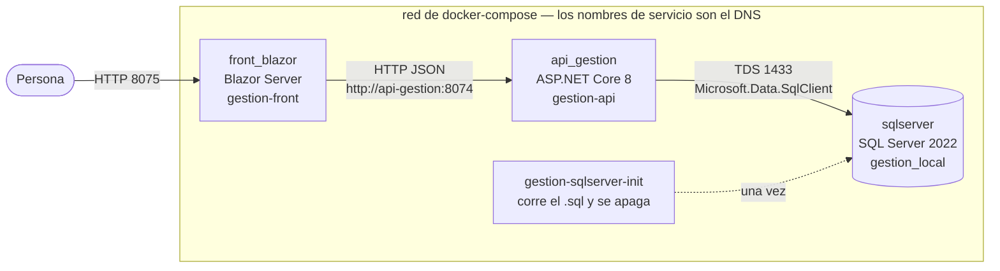
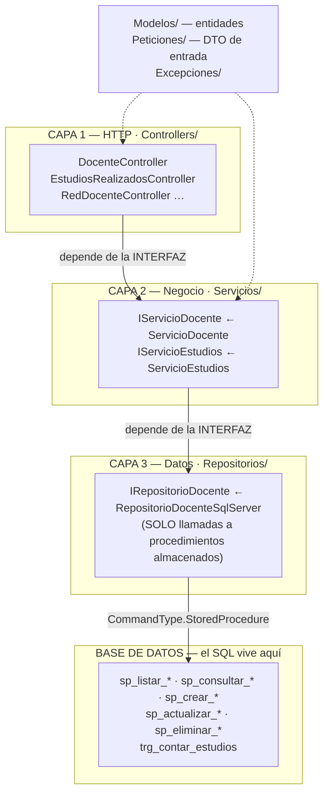
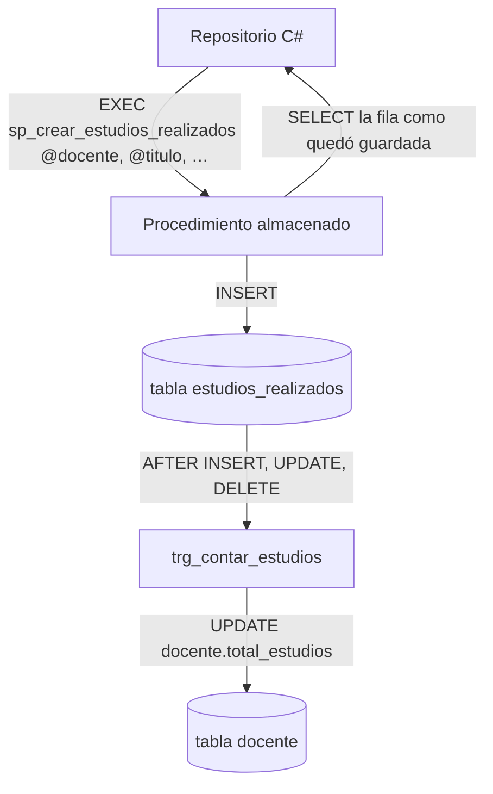
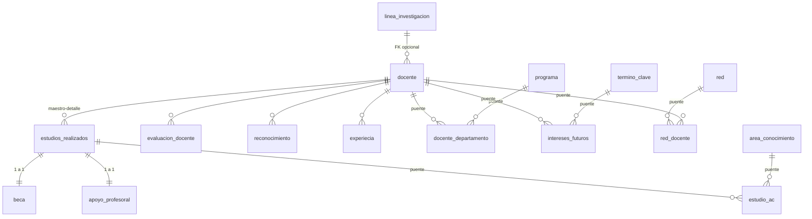

# Arquitectura — Versión 2 · Módulo Gestión Profesoral

> Qué hay, por qué está así, y dónde se ve cada decisión en el código.
> Este documento es el que se sustenta cuando preguntan «¿cómo se dio la
> arquitectura?». No describe un ideal: describe lo que el repositorio tiene
> (v1) y lo que la v2 le agrega, señalando el archivo exacto.

---

## 1. La foto completa: tres procesos, una red

La v1 ya dejó montado el despliegue. La v2 **no lo cambia**: le agrega
recursos dentro de los mismos tres contenedores.



**Lo que hay que saber decir en la sustentación:**

| Pregunta | Respuesta corta |
|---|---|
| ¿Por qué tres contenedores y no uno? | Cada proceso se despliega, se reinicia y se escala por separado. Si el front cae, la API sigue respondiendo (y se comprueba con Postman). |
| ¿Por qué el front no habla con la base? | Porque entonces habría **dos** sitios con reglas de negocio. El front solo consume el contrato HTTP. |
| ¿Por qué `http://api-gestion:8074` y no `localhost`? | Dentro de un contenedor `localhost` es el contenedor mismo. El nombre del servicio en `docker-compose.yml` es el nombre DNS de la red. |
| ¿Qué comparten el front y la API? | **Solo el JSON.** `front_blazor/Servicios/ServicioPrograma.cs` declara su propia clase `Programa`, a propósito: si compartieran una biblioteca dejarían de ser independientes. |

---

## 2. Las capas de la API (el corazón de la sustentación)



### La regla de oro: la dirección de las flechas

**Cada capa conoce la interfaz de la siguiente, nunca su clase concreta.**
El único sitio del proyecto donde una clase concreta aparece junto a su
interfaz es el ensamblador, en `api_gestion/Program.cs`:

```csharp
builder.Services.AddScoped<IRepositorioPrograma, RepositorioProgramaSqlServer>();
builder.Services.AddScoped<IServicioPrograma, ServicioPrograma>();
// v2 — se agregan aquí, y en ningún otro sitio:
builder.Services.AddScoped<IRepositorioDocente, RepositorioDocenteSqlServer>();
builder.Services.AddScoped<IServicioDocente, ServicioDocente>();
```

**Por qué esto se puede demostrar y no solo afirmar:** existe
`api_gestion/pruebas/`, que prueba el servicio con un repositorio **de
mentiras** (un objeto que implementa `IRepositorioPrograma` y no toca SQL
Server). Esa prueba **corre sin base de datos**. Si el servicio tuviera
dentro una cadena de conexión, la prueba no compilaría. *La prueba es la
demostración de que las capas existen de verdad.*

### Qué hace cada capa, y qué tiene prohibido

| Capa | Hace | Tiene PROHIBIDO |
|---|---|---|
| **1. Controlador** | Lee la ruta y el cuerpo, traduce `Peticiones/` → `Modelos/`, traduce excepciones a códigos HTTP | Reglas de negocio · SQL · conocer `SqlConnection` |
| **2. Servicio** | Las reglas: validaciones, el 409 de integridad, decidir si un maestro con detalle activo se puede retirar | Conocer `HttpContext`, `IActionResult` ni las clases de `Peticiones/` |
| **3. Repositorio** | **Llamar** al procedimiento almacenado con sus parámetros, mapear filas a entidades | **Escribir SQL a mano** · concatenar texto · tomar decisiones de negocio |
| **Base de datos** | El SQL: `SELECT`, `INSERT`, `JOIN`, el disparador | — |

> **El cambio de la v2 respecto de la v1:** en la v1 el repositorio escribía
> SQL con Dapper (`SELECT TOP (@Limite) … FROM programa`). En la v2 **ese SQL
> se muda a procedimientos almacenados** y el repositorio pasa a ser una
> llamada. Es el criterio 3 de aceptación: *se abre el repositorio y no hay
> SQL escrito a mano.*

---

## 3. Cómo se ve ese cambio en el código

**v1 — el SQL en C# (`RepositorioProgramaSqlServer.cs`):**

```csharp
var sql = $@"SELECT TOP (@Limite) {COLUMNAS} FROM programa
             WHERE activo = 1 ORDER BY id ASC";
return await conexion.QueryAsync<Programa>(sql, new { Limite = limite });
```

**v2 — la llamada al procedimiento (`RepositorioDocenteSqlServer.cs`):**

```csharp
public async Task<IEnumerable<Docente>> ObtenerTodos(int limite)
{
    using var conexion = CrearConexion();
    return await conexion.QueryAsync<Docente>(
        "sp_listar_docente",                       // el nombre, no el SQL
        new { Limite = limite },                   // parámetros, nunca texto pegado
        commandType: CommandType.StoredProcedure); // esta línea es el criterio 3
}
```

| | v1 | v2 |
|---|---|---|
| Dónde vive el `SELECT` | En el `.cs` | En `db/gestion_profesoral.sql`, con nombre y versionado |
| Qué pasa si cambia una columna | Se recompila la API | Se altera el procedimiento, la API no se toca |
| Inyección de SQL | Evitada por parametrizar | Evitada por parametrizar **y** porque no hay texto que pegar |

---

## 4. Los patrones que hay, y por qué

| Patrón | Dónde | Qué problema resuelve |
|---|---|---|
| **Arquitectura en capas** | `Controllers/` · `Servicios/` · `Repositorios/` | Cambiar el motor de base de datos no obliga a tocar el negocio |
| **Repositorio** | `IRepositorioPrograma` | El negocio pide «dame los docentes activos», no «ejecuta este SQL» |
| **Inyección de dependencias** | `Program.cs` + constructores | Permite la prueba sin base de datos |
| **DTO** | `Peticiones/ProgramaCrear.cs`, `ProgramaActualizar.cs` | El cuerpo HTTP no es la entidad: se valida en la frontera y nunca entra crudo al negocio |
| **Excepciones de dominio** | `Excepciones/NoEncontradoExcepcion.cs` | El servicio no sabe qué es un 404; lanza «no lo encontré» y el controlador traduce |
| **Sobre de respuesta** | `{tabla, limite, total, datos}` | Una lista pelada no puede crecer; el sobre sí |

### SOLID, con el ejemplo del repositorio al lado

- **S** — `ServicioDocente` decide; `RepositorioDocenteSqlServer` persiste. Dos razones de cambio, dos clases.
- **O** — para cambiar a PostgreSQL se **agrega** `RepositorioDocentePostgres` y se cambia **una línea** de `Program.cs`. No se modifica el servicio.
- **L** — cualquier `IRepositorioDocente` sirve, incluido el de mentiras de las pruebas.
- **I** — interfaces por recurso (`IRepositorioDocente`, `IRepositorioEstudios`), no una interfaz gigante.
- **D** — el servicio depende de `IRepositorioDocente` (abstracción), no de la clase de SQL Server.

---

## 5. Lo que la v2 agrega a la arquitectura (el delta)

### 5.1 Un recurso nuevo = una rebanada vertical completa

Para **cada** una de las 11 tablas con clave foránea, los mismos seis archivos:

```
api_gestion/
  Modelos/Docente.cs                          ← la entidad
  Peticiones/DocenteCrear.cs                  ← DTO con [Required], [StringLength]
  Peticiones/DocenteActualizar.cs
  Repositorios/IRepositorioDocente.cs         ← el contrato de datos
  Repositorios/RepositorioDocenteSqlServer.cs ← llamadas a sp_*
  Servicios/IServicioDocente.cs
  Servicios/ServicioDocente.cs                ← las reglas
  Controllers/DocenteController.cs            ← HTTP
```

### 5.2 Tres piezas nuevas que la v1 no necesitaba

| Pieza | Archivo | Por qué aparece ahora |
|---|---|---|
| **`ConflictoExcepcion`** | `Excepciones/ConflictoExcepcion.cs` | La v1 no tenía claves foráneas, así que no tenía 409 |
| **`TraductorErroresSql`** | `Repositorios/TraductorErroresSql.cs` | Convierte `SqlException` 547 (FK violada) y 2627/2601 (clave duplicada) en `ConflictoExcepcion` con mensaje en castellano. **Sin esto, el criterio 7 falla con un 500** |
| **Alta por lote transaccional** | `ServicioEstudios.CrearVarios(...)` | Tres renglones del detalle en **un solo envío** y una sola transacción: o entran los tres o no entra ninguno |

```csharp
// Repositorios/TraductorErroresSql.cs — la pieza que convierte un 500 en un 409
public static Exception Traducir(SqlException ex) => ex.Number switch
{
    547          => new ConflictoExcepcion(
                       "El registro al que hace referencia no existe o tiene hijos activos."),
    2627 or 2601 => new ConflictoExcepcion(
                       "Ya existe un registro con esa clave."),
    _            => ex
};
```

### 5.3 La transacción del alta múltiple (principios ACID)

```csharp
public async Task CrearVarios(int docente, IEnumerable<Estudio> estudios)
{
    using var conexion = CrearConexion();
    conexion.Open();
    using var transaccion = conexion.BeginTransaction();   // A: atomicidad
    try
    {
        foreach (var e in estudios)
            await conexion.ExecuteAsync("sp_crear_estudios_realizados",
                new { e.Titulo, e.Universidad, Docente = docente, /* … */ },
                transaccion, commandType: CommandType.StoredProcedure);

        transaccion.Commit();   // o entran todos…
    }
    catch
    {
        transaccion.Rollback(); // …o no entra ninguno. «Medio registro» no es un estado del negocio
        throw;
    }
}
```

---

## 6. Dónde entra la base de datos: lo que se mueve a SQL



**Dos cosas que hay que saber explicar:**

1. **El procedimiento devuelve la fila como quedó guardada**, no como la mandó
   el formulario. Así la respuesta trae los valores por defecto de la base y lo
   que calculó el disparador.
2. **El disparador escucha `INSERT`, `UPDATE` *y* `DELETE`.** Con borrado
   lógico, retirar un hijo es un `UPDATE`: un disparador que solo oiga
   `INSERT`/`DELETE` deja el contador mal justo cuando alguien retira algo.

---

## 7. El modelo de datos de la v2

Las 11 tablas con clave foránea del módulo, y de quién cuelgan:



| Clase de tabla | Cuáles | Cómo se trata en la interfaz |
|---|---|---|
| **Detalle de `docente`** | `estudios_realizados`, `evaluacion_docente`, `reconocimiento`, `experiecia` | Se ven y se agregan **desde la ficha del docente** |
| **Puente (PK compuesta, 2 FK)** | `docente_departamento`, `intereses_futuros`, `red_docente`, `estudio_ac` | Se **asignan** y se **retiran**. No tienen botón de editar: una pareja existe o no existe |
| **Extensión 1 a 1** | `apoyo_profesoral`, `beca` | Panel dentro de la ficha del estudio |
| **Maestro con FK opcional** | `docente` → `linea_investigacion` | Desplegable con opción **«(ninguna)» → `null`** |

---

## 8. Las decisiones de arquitectura de esta versión (y su porqué)

| # | Decisión | Alternativa descartada | Por qué |
|---|---|---|---|
| **AD-1** | Procedimientos almacenados para los 5 verbos | Seguir con SQL en Dapper | El SQL queda en un sitio, con nombre y versionado; y es el criterio 3 |
| **AD-2** | Dapper + `CommandType.StoredProcedure` | Entity Framework | EF genera SQL propio y escondería el procedimiento, que es justo lo que hay que mostrar |
| **AD-3** | Borrado **lógico** en todas las tablas | `DELETE` físico | El esquema ya trae `activo BIT DEFAULT 1` en las 19 tablas: manda el esquema |
| **AD-4** | **No** se puede retirar un docente con detalle activo | Dejar que la base decida | Con borrado lógico la base no lo impide (es un `UPDATE`): **es una regla de negocio**, va en `ServicioDocente`, y se escribe en el `2_spec.md` |
| **AD-5** | El alta múltiple de detalle va en **una transacción** | Una petición por renglón | Si la tercera falla, no puede quedar medio registro guardado |
| **AD-6** | La traducción de errores SQL vive en la **capa 3** | En el controlador | El controlador no debe conocer `SqlException`: eso es una fuga de la capa de datos |
| **AD-7** | Un contrato HTTP por tabla (`/api/docente`, `/api/estudios-realizados`) | Un endpoint genérico `/api/{tabla}` | Un endpoint genérico no se puede documentar, validar ni versionar |
| **AD-8** | El detalle se anida en la ruta: `/api/docente/{cedula}/estudios` | `/api/estudios?docente=X` | La ruta dice lo que el negocio dice: *un estudio no existe sin su docente* |

---

## 9. Cómo se comprueba que la arquitectura es real

| Afirmación | Cómo se demuestra en vivo |
|---|---|
| «Hay tres capas» | Se corre `dotnet test` en `api_gestion/pruebas/`: el servicio pasa **sin base de datos** |
| «No hay SQL en el repositorio» | `grep -ri "SELECT\|INSERT\|UPDATE" api_gestion/Repositorios/` → sin resultados |
| «Todo pasa por procedimientos» | `grep -c "StoredProcedure" api_gestion/Repositorios/*.cs` → 5 por tabla |
| «El disparador funciona» | Se agrega un estudio **por la interfaz** y `docente.total_estudios` cambia sin que la API lo haya enviado |
| «Un padre inexistente da 409» | Colección de Postman, petición *«crear estudio con docente inexistente»* → 409 en castellano |
| «La v1 sigue en verde» | Se corre la colección `postman/coleccion_v1.postman_collection.json` completa |
