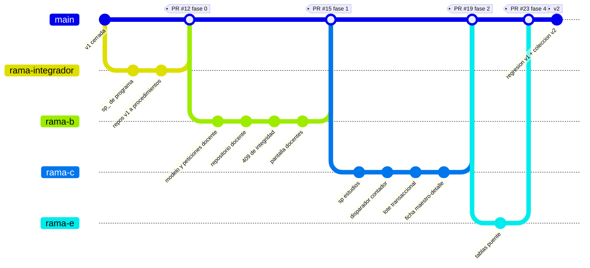

# Ramas, commits y entrega — Versión 2

> Las reglas son las de `0_METODOLOGIA.md` §5.1, y **se califican**: la fila
> «Git y GitHub» de la rúbrica se pierde entera con un commit directo a
> `main` o con «un solo commit con todo».
>
> Y en la sustentación individual, **sus commits son su evidencia**: una rama
> con un solo commit gigante la noche anterior es una sustentación sin nada
> que respalde lo que se dice.

---

## 1. Lo que no se negocia

| | Regla |
|---|---|
| **1** | **Nadie trabaja en `main`.** Ni un commit directo. Nunca |
| **2** | Cada integrante tiene **su** rama: `rama-<su nombre>` |
| **3** | Hay **un encargado del main** (el integrador). También tiene su rama; su rol extra es ser **el único** que hace merge |
| **4** | Todo llega a `main` por **Pull Request** |
| **5** | El cierre de la versión es un **tag `v2`** sobre `main`, puesto por el encargado cuando los doce criterios pasan |
| **6** | Commits **pequeños, frecuentes y descriptivos en castellano**. «avances» no es un mensaje |
| **7** | Los dos repositorios son **privados** y `ccastro2050` es colaborador desde el primer día |

---

## 2. El mapa de ramas de la v2



**Cómo se lee:** cada rama es una persona, no una funcionalidad suelta. Las
fases del `8_tasks.md` están repartidas de forma que **dos personas no tocan
los mismos archivos**: así los PR no chocan.

---

## 3. Las ramas, una por integrante

| Rama | Integrante | Fases del `8_tasks.md` | Archivos que toca (y nadie más) |
|---|---|---|---|
| `rama-______` | *(encargado del main)* | 0 y 6 | Los 5 repositorios de la v1 · los `sp_*` de la v1 · `README.md` |
| `rama-______` | | 1 | `*Docente*` · `TraductorErroresSql.cs` · `Docentes.razor` |
| `rama-______` | | 2 | `*Estudios*` · `trg_contar_estudios` · `FichaDocente.razor` |
| `rama-______` | | 3 y 5 | `*Evaluacion*` · `*Reconocimiento*` · `*Experiencia*` · `*Apoyo*` · `*Beca*` |
| `rama-______` | | 4 | Las 4 puente y sus pantallas |

> **Program.cs es el único archivo que todos tocan** (las dos líneas del
> ensamblador). Para que no choque: **cada quien agrega sus dos líneas al
> final de su bloque**, y quien resuelve el conflicto conserva las dos
> versiones. Es un conflicto de una línea, no un problema.

---

## 4. Cómo se escribe un commit aquí

### El formato

```
<tipo>(<alcance>): <qué cambió, en castellano y en presente>

<por qué, si no es obvio por el título>
```

### Los tipos

| Tipo | Para qué |
|---|---|
| `feat` | Funcionalidad nueva |
| `fix` | Un arreglo |
| `refactor` | Cambia la forma, no el comportamiento (la migración a procedimientos) |
| `docs` | Spec kit, README, guía de IA |
| `test` | Pruebas |
| `db` | Script de la base: procedimientos, disparadores |

### Comparación, que es lo que se califica

| ❌ No vale | ✅ Vale |
|---|---|
| `avances` | `feat(docente): CRUD completo por procedimientos almacenados` |
| `cambios` | `fix(disparador): escuchar también el UPDATE, o el contador no baja al retirar` |
| `arreglo bug` | `fix(estudios): un docente inexistente responde 409 y ya no 500` |
| `subo todo` | `refactor(v1): los 5 repositorios pasan a llamar procedimientos` |
| `pantalla` | `feat(front): el detalle del docente se ve y se agrega en su misma ficha` |
| `update readme` | `docs(spec): decisión D2 — no se retira un maestro con detalle activo` |

> **La prueba de un buen mensaje:** léalo dentro de seis meses, sin ver el
> diff. Si no sabe qué cambió, el mensaje no sirvió.

### Un ejemplo completo, con su porqué

```
fix(disparador): escuchar también el UPDATE

Con borrado lógico, retirar un estudio es un UPDATE activo = 0, no un
DELETE. El disparador solo oía INSERT y DELETE, así que total_estudios
subía al agregar y no bajaba al retirar — y el criterio 4 se comprueba
retirando, que es el caso que nadie prueba.
```

---

## 5. El Pull Request

### Quién hace qué

| | |
|---|---|
| **El autor** | Abre el PR desde su rama hacia `main` |
| **El encargado del main** | Revisa: ¿compila? ¿cumple la spec? ¿los criterios anteriores siguen pasando? |
| **El merge** | **Solo el encargado.** Nadie más |

### Plantilla del PR

```markdown
## Qué entrega
Fase 2 del 8_tasks.md: estudios_realizados, el disparador y el lote.

## Qué parte de la spec cumple
- 2_spec.md RF1, RF2, RF5, RF6, RF8
- Historias H7 y H8 de 0_historias_de_usuario.md

## Criterios que deja en verde
- [x] 4 — el disparador funciona (probado POR LA INTERFAZ, agregando y retirando)
- [x] 9 — el detalle se ve y se agrega desde el maestro

## Cómo lo comprobó quien lo revisa
1. `docker compose down -v && docker compose up -d --build`
2. Abrir un docente, agregar un estudio, recargar: total_estudios subió
3. Retirar ese estudio: total_estudios bajó
4. Postman → «Deben fallar» → lote con un elemento malo: 409 y nada guardado

## Regresión
La colección de la v1 corrió completa: en verde.
```

---

## 6. El cierre: el tag

Cuando los doce criterios están en verde y el `9_checklist.md` está firmado:

```bash
git checkout main
git pull
git tag -a v2 -m "Version 2: las 11 tablas con clave foranea, todo el CRUD por procedimientos almacenados, trg_contar_estudios y 409 de integridad"
git push origin v2
```

> **Las versiones NO son repositorios.** Las cuatro viven en el mismo
> repositorio, y para ver una anterior se abre **su tag**, no otro repo.
>
> ```
> main ──●────────●────────●────────●──▶
>        │        │        │        │
>      tag v1   tag v2   tag v3   tag v4
> ```

---

## 7. Secretos: lo que anula el criterio de seguridad

| | |
|---|---|
| La cadena de conexión va por **variable de entorno** | `ConnectionStrings__SqlServer` en el `environment:` del compose |
| El **`.env` nunca se sube** | Está en `.gitignore` desde el primer commit |
| El **`.env.example` sí se sube** | Las mismas variables con valores de mentira |
| Si un secreto se subió por error | **Rotarlo de inmediato.** Borrarlo del último commit no basta: quedó en la historia |

**`.env.example` de este proyecto:**

```bash
# Contraseña del usuario sa de SQL Server (la real NO va aquí)
SA_PASSWORD=CambieEstaClave123!
# La arma docker-compose.yml a partir de la de arriba
ConnectionStrings__SqlServer=Server=sqlserver,1433;Database=gestion_local;User Id=sa;Password=CambieEstaClave123!;TrustServerCertificate=True;
UrlApi=http://api-gestion:8074
```

---

## 8. Checklist de Git antes de entregar

| | ✔ |
|---|---|
| Los dos repos son privados y `ccastro2050` es colaborador | ☐ |
| `git log main --first-parent` muestra **solo merges de PR** | ☐ |
| Cada integrante tiene al menos **6–10 commits propios** en su rama, repartidos en el tiempo | ☐ |
| Ningún mensaje dice «avances», «cambios» ni «subo todo» | ☐ |
| Todos los PR están cerrados con merge del **encargado** | ☐ |
| El tag `v2` está puesto y empujado | ☐ |
| El `.env` **no** aparece en `git ls-files` | ☐ |
| `.env.example` **sí** aparece | ☐ |

**Comando para revisarlo en un minuto:**

```bash
git log main --first-parent --oneline        # deberían ser solo merges
git shortlog -sn --all                       # cuántos commits por persona
git ls-files | grep -c "^\.env$"             # tiene que dar 0
git tag                                      # v1 y v2
```
