# Tareas — Versión 2

> El orden de construcción, con **una compuerta al final de cada fase**.
> Nadie pasa de fase con su «Verificar» en rojo.

## 1. Las fases y sus compuertas

```mermaid
flowchart TD
    F0["<b>FASE 0 — Cerrar la v1 y migrar su SQL</b><br/>los 5 repositorios de la v1 pasan a procedimientos"]
    V0{"Verificar:<br/>la coleccion v1 entera en verde<br/>Y grep de SQL en Repositorios/ sin resultados"}

    F1["<b>FASE 1 — docente</b><br/>8 archivos + 5 procedimientos + pantalla<br/>+ desplegable de linea con «(ninguna)»"]
    V1{"Verificar:<br/>crear docente sin linea -> 200 con null<br/>crear con linea inexistente -> 409"}

    F2["<b>FASE 2 — estudios_realizados</b><br/>rutas anidadas + lote transaccional<br/>+ trg_contar_estudios"]
    V2{"Verificar:<br/>agregar estudio POR LA INTERFAZ y<br/>total_estudios cambia solo<br/>+ lote con 1 malo -> no entro ninguno"}

    F3["<b>FASE 3 — los otros 3 detalles</b><br/>evaluacion_docente · reconocimiento · experiecia"]
    V3{"Verificar:<br/>los tres se ven y se agregan<br/>DESDE la ficha del docente"}

    F4["<b>FASE 4 — las 4 tablas puente</b><br/>docente_departamento · intereses_futuros<br/>red_docente · estudio_ac"]
    V4{"Verificar:<br/>asignar · repetir -> 409 · retirar<br/>y ningun boton de editar"}

    F5["<b>FASE 5 — las 2 extensiones 1 a 1</b><br/>apoyo_profesoral · beca"]
    V5{"Verificar:<br/>panel dentro de la ficha del estudio"}

    F6["<b>FASE 6 — cierre</b><br/>regresion v1 + coleccion v2 + README + PR a main"]
    V6{"Verificar:<br/>los DOCE criterios en verde"}

    TAG(["<b>tag v2</b> sobre main<br/>lo pone el encargado del main"])

    F0 --> V0 -->|verde| F1 --> V1 -->|verde| F2 --> V2 -->|verde| F3
    F3 --> V3 -->|verde| F4 --> V4 -->|verde| F5 --> V5 -->|verde| F6
    F6 --> V6 -->|verde| TAG
    V0 -->|rojo| F0
    V1 -->|rojo| F1
    V2 -->|rojo| F2
    V3 -->|rojo| F3
    V4 -->|rojo| F4
    V5 -->|rojo| F5
    V6 -->|rojo| F6
```

**Cómo se lee:** los rombos no son adorno. **Una fase no está hecha porque
el código compile**: está hecha cuando su «Verificar» pasa. La flecha roja
vuelve a la misma fase, no a la siguiente.

## 2. El detalle, tarea por tarea

### FASE 0 — Cerrar la v1 y migrar su SQL *(encargado: el integrador)*

| # | Tarea | Hecho cuando |
|---|---|---|
| 0.1 | Correr la colección de la v1 completa | Todo en verde |
| 0.2 | Escribir `sp_listar/consultar/crear/actualizar/eliminar_programa` | Los 5 existen en el script |
| 0.3 | Lo mismo para `area_conocimiento`, `termino_clave`, `linea_investigacion`, `red` | 25 procedimientos |
| 0.4 | Cambiar los 5 repositorios a `CommandType.StoredProcedure` | `grep` sin resultados |
| 0.5 | Arreglar el 500 de clave duplicada → 409 | Crear un programa repetido da 409 |
| 0.6 | Volver a correr la colección de la v1 | Todo en verde **otra vez** |

### FASE 1 — `docente`

| # | Tarea |
|---|---|
| 1.1 | `ALTER TABLE docente ADD total_estudios INT NOT NULL DEFAULT 0` |
| 1.2 | Los 5 `sp_*_docente`, con el de crear devolviendo la fila |
| 1.3 | `Modelos/Docente.cs` · `Peticiones/DocenteCrear.cs` · `DocenteActualizar.cs` |
| 1.4 | `IRepositorioDocente` + `RepositorioDocenteSqlServer` |
| 1.5 | `TraductorErroresSql` + `ConflictoExcepcion` |
| 1.6 | `IServicioDocente` + `ServicioDocente` (incluye la regla D2) |
| 1.7 | `DocenteController` con las 6 rutas |
| 1.8 | Registrar las 2 líneas en `Program.cs` |
| 1.9 | Pantalla `Docentes.razor` + desplegable de línea con «(ninguna)» |
| 1.10 | Prueba de capas de `ServicioDocente` con repositorio falso |

### FASE 2 — `estudios_realizados` *(la rebanada que se sustenta)*

| # | Tarea |
|---|---|
| 2.1 | Los 5 `sp_*_estudios_realizados` + `sp_listar_estudios_por_docente` |
| 2.2 | `trg_contar_estudios` escuchando `INSERT, UPDATE, DELETE` |
| 2.3 | Las 8 clases de la rebanada |
| 2.4 | `EstudiosController` con rutas **anidadas** bajo `/api/docente/{cedula}` |
| 2.5 | `CrearVarios` con `BeginTransaction` / `Commit` / `Rollback` |
| 2.6 | `POST …/estudios/lote` |
| 2.7 | La ficha del docente: datos arriba, **sus estudios abajo**, botón «Agregar» |
| 2.8 | Prueba: el lote con un elemento malo no deja nada guardado |

### FASES 3 a 5 — el mismo patrón

Cada tabla: 5 procedimientos + 8 archivos + su pantalla. **Las puente llevan
las dos claves en la ruta y no tienen editar.**

### FASE 6 — cierre

| # | Tarea |
|---|---|
| 6.1 | Correr la colección v1 **y** la v2, incluida la carpeta «Deben fallar» |
| 6.2 | Recorrer las 12 casillas del `9_checklist.md` |
| 6.3 | Revisar que ninguna pantalla diga «PUT», «PATCH», «422» ni «FK» |
| 6.4 | `GUIA_IA2.md` con los prompts reales de cada integrante |
| 6.5 | README con el quickstart de la v2 |
| 6.6 | PR final a `main` + **tag `v2`** |

## 3. Reparto por integrante (y es lo que se sustenta)

> Cada quien responde por **su rama** y por **sus archivos**. La columna de
> la derecha es lo que le van a pedir que explique en voz alta.

| Integrante | Rama | Fases | Lo que tiene que poder contar |
|---|---|---|---|
| **Integrante A** *(encargado del main)* | `rama-<nombre>` | 0 y 6 | Por qué el SQL se mudó a la base; por qué la constitución se enmendó en vez de «dejarlo pasar» |
| **Integrante B** | `rama-<nombre>` | 1 | El desplegable con «(ninguna)» → `null`; por qué `null` no es cadena vacía |
| **Integrante C** | `rama-<nombre>` | 2 | El disparador y la transacción: por qué escucha el `UPDATE` y qué pasa si el tercer renglón falla |
| **Integrante D** | `rama-<nombre>` | 3 y 5 | Maestro-detalle en una pantalla; por qué el detalle no tiene pantalla propia |
| **Integrante E** | `rama-<nombre>` | 4 | Por qué una tabla puente no se edita; de dónde sale el 409 de la pareja repetida |

**Nadie entrega una fase que no pueda explicar.** Si la IA la escribió y el
integrante no la entendió, todavía no está entregada: está pegada
(metodología §2.2).
